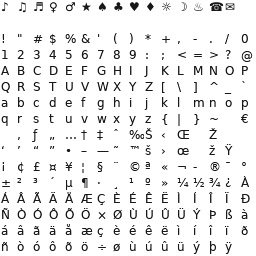

# Textes de dialogue du jeu

**Fichiers concernés:**
- `SAKURA1/{nnnn}TBL.BIN/{nnnn}TBL.TXT` où `nnnn` est un décimal correspondant à la séquence[^sequence] du jeu.
  Des [.txt](https://fr.wikipedia.org/wiki/Fichier_texte) encodés au format unicode, contenant le texte de la séquence.

## Description

Ces fichiers correspondent à des sections de script, et chaque ligne préfixée d'un `{index de ligne}:` désigne une entrée de dialogue. Le moteur du jeu ne contient PAS de scroll: ainsi, une ligne du fichier correspond à une seule entrée de dialogue, qui sera contenue dans un seul affichage d'une fenêtre de dialogue du jeu.

Une fenêtre de dialogue correspond à quatre lignes d'affichage de `16px` de haut chacune, sur `240px` de large.

Pour faire court, vu qu'on parle de quatre types de "ligne":
- Index de ligne: 0001, 0002, etc. L’identifiant numérique
- Entrée de dialogue: le contenu associé à cet index.
- Ligne du fichier: la ligne physique du TXT.
- Ligne d’affichage: une ligne visible dans la fenêtre du jeu.

> [!NOTE]
> Vous pouvez éditer vous-même les fichiers si vous avez envie de faire de l'édition en local pour tester immédiatement, mais en pratique, mieux vaut employer [l'application collaborative](https://sakurayaku.dreamleaves.org/app/).

> [!CAUTION]
> Une entrée de dialogue peut aussi contenir un choix LIPS[^lips]. Toutefois, le décodeur et l'encodeur n'ont AUCUN moyen de détecter leur différence avec une entrée de dialogue normale.

## Contraintes d'édition

- Chaque entrée de dialogue doit commencer par son index de ligne sur 4 chiffres, suivi d'un deux-points.
- Chaque entrée de dialogue doit commencer par un index de ligne supérieur à celui de la précédente.
- Chaque entrée de dialogue doit être contenue dans une seule ligne du fichier texte. Pour forcer un retour à la ligne, utilisez `<br>`.
- L'encodeur insère lui-même des retours à la ligne si un caractère empiète sur les `240px` de largeur. Il vous appartient donc de calculer des césures propres, ou revenir manuellement à la ligne au besoin.
- Le texte ne doit employer que des caractères présents dans la police du jeu.

Afin de permettre une facilité de lecture, vous pouvez commenter le fichier texte en utilisant le `#` en début de ligne, ou même espacer les lignes pour séparer des blocs. Toutefois, il n'y a pas de notion de "commentaire terminal" comme dans un langage de programmation: une ligne est intégralement un commentaire, ou elle est intégralement du texte.

> [!CAUTION]
> Les entrées de choix LIPS[^lips] ont un fonctionnement différent: elles contiennent les choix disponibles, séparés par un `<br>`. Il vous appartient de calculer proprement les longueurs de ligne pour ne pas introduire une ligne de trop que le jeu n'attend pas. Il n'y a AUCUN moyen pour l'encodeur de détecter cela en amont.

L'encodeur valide explicitement ces règles avant d'insérer le texte.

Exemple de script:
```txt
# Premier texte du jeu
0001:Ceci est le premier texte du jeu !<br>Bienvenue dans le monde magi-<br>que de Sakura Wars!

# Discussion avec Sakura
0002:Bonjour Ogami ! Vous avez bien dormi?
# CHOICE: => 0004 => 0006
0003:Ouais super !<br>Euh...bof ?

# RESULT <= 0003
0004:J'ai super bien dormi, merci Sakura !
0005:Je suis ravie de l'entendre

# RESULT <= 0003
0006:Euh...bof ? Je crois que je suis malade
0007:Oh non ! Pauvre Ogami

# Discussion avec Sumire
0008:Bonjour Ogami !
```

Dans cet exemple, les commentaires `CHOICE` et `RESULT` sont totalement arbitraires pour faciliter la relecture des traducteurs.

## Notes

La police du jeu est basée sur la table [Windows-1252](https://fr.wikipedia.org/wiki/Windows-1252), qui inclut pas mal d'accents européens. Elle contient aussi des symboles unicodes:

- Notes de musique `♪ ♫ ♬`
- Symboles genrés `♀ ♂`
- Divers `★ ♠ ♣ ♥ ♦ ☼ ☽ ♨ ☎ ✉`

Atlas complet de tous les glyphes disponibles:


***
[^sequence]: Le jeu est séparé en dix épisodes, eux-même séparés (dans les fichiers de dialogues du jeu) en plusieurs séquences. Ainsi vous pouvez trouver `0100TBL` pour le premier épisode, `0604TBL` pour le sixième, ou `1004TBL` pour le dixième. Le nombre de séquences dépend de chaque épisode. Vous pouvez vous référer aux fichiers `{nnnn}TBL.BIN` pour les deviner.
[^lips]: Le [Live & Interactive Picture System](https://sakurawars.fandom.com/wiki/LIPS_System) est le système de choix du jeu.